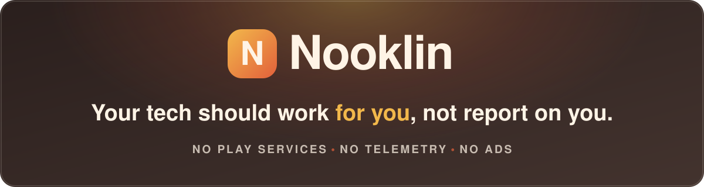
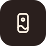

  

<h1 align="center">Welcome to Nooklin!</h1>

  Nooklin is a growing suite of free, privacy focused, open-source Android apps with a little iOS design influence. 
  Built by and for people who'd rather self-host than pay with their data.

  
  
  
  
  

  
  
  

<h2 align="center">🎯 Our Mission</h2>

<b><i>Your tech should work for you, not report on you.</i></b>

Nooklin makes free, privacy focused, open-source Android apps with a touch of iOS-inspired design, for people who want that polished design without the walled garden. We started during our own switch from iOS to GrapheneOS, and we build what we missed. No Play Services, no telemetry, no ads. Ever.

<h2 align="center">🛡️ Principles</h2>

<table align="center">
  <tr align="center">
    <td align="center" width="20%" valign="top">
      
      <h4 align="center">No Play Services</h4>
      
No Google Play Services dependencies.

    </td>
    <td align="center" width="20%" valign="top">
      
      <h4 align="center">No telemetry</h4>
      
No analytics, no tracking, no logging to Apple or Google.

    </td>
    <td align="center" width="20%" valign="top">
      
      <h4 align="center">No ads</h4>
      
Ever.

    </td>
    <td align="center" width="20%" valign="top">
      
      <h4 align="center">Self-hosting friendly</h4>
      
Built for people who'd rather self-host than pay with their data.

    </td>
    <td align="center" width="20%" valign="top">
      
      <h4 align="center">Open source</h4>
      
GPL-3.0, so every derivative work stays free too.

    </td>
  </tr>
</table>

<h2 align="center">📱 Apps</h2>

<h3 align="center">✅ Available now</h3>

<table align="center">
  <tr align="center">
    <td align="center" width="50%">
      
    </td>
    <td align="center" width="50%">
      
    </td>
  </tr>
  <tr align="center">
    <td align="center" width="50%">
      
<h3 align="center"><a href="https://github.com/Nooklin/Music">Music</a></h3>

    </td>
    <td align="center" width="50%">
      
<h3 align="center"><a href="https://github.com/Nooklin/Photos">Photo's</a></h3>

      </td>
  </tr>
  <tr align="center">
    <td align="center" width="50%" valign="top">
      
A Navidrome music player with built-in AirPlay support.

    </td>
    <td align="center" width="50%" valign="top">
      
A privacy-focused, offline photo gallery. On-device face recognition, a Hidden section and backup export.

    </td>
  </tr>
  <tr align="center">
    <td align="center" width="50%">
      
      
    </td>
    <td align="center" width="50%">
      
      
    </td>
  </tr>
  <tr align="center">
    <td align="center" width="50%">
      
    </td>
    <td align="center" width="50%">
      
    </td>
  </tr>
</table>

<h3 align="center">🚧 In development</h3>

Not released yet.

<table align="center">
  <tr align="center">
    <td align="center" width="50%" valign="top">
      
      <h3 align="center">AirSync</h3>
      
Streams system audio to AirPlay receivers over your local network. Privacy focused, no Apple or Google telemetry/logging.

      
    </td>
    <td align="center" width="50%" valign="top">
      
      <h3 align="center">Calendar</h3>
      
A privacy-focused calendar app.

      
    </td>
  </tr>
  <tr align="center">
    <td align="center" width="50%" valign="top">
      
      <h3 align="center">Camera</h3>
      
A privacy-focused camera app.

      
    </td>
    <td align="center" width="50%" valign="top">
      
      <h3 align="center">Contacts</h3>
      
A privacy-focused contacts app.

      
    </td>
  </tr>
  <tr align="center">
    <td align="center" width="50%" valign="top">
      
      <h3 align="center">Files</h3>
      
A privacy-focused file manager.

      
    </td>
    <td align="center" width="50%" valign="top">
      
      <h3 align="center">Wallpaper</h3>
      
A wallpaper app with iOS-inspired wallpaper features.

      
    </td>
  </tr>
</table>

<h2 align="center">💜 Support Nooklin</h2>

Building these apps takes time and resources. Contributions are never required, but they're deeply appreciated.

<h2 align="center">📄 License</h2>

Nooklin apps are released under GPL-3.0: free to use, free to modify, and any derivative work stays free too.

<h2 align="center">🤝 Get involved</h2>

Found a bug or have an idea? Open an issue or pull request on the relevant app's repository.

Have a question, or just want to say hi? Reach out at <a href="mailto:info@nooklin.org">info@nooklin.org</a>.

  Nooklin · Free, open-source Android apps under GPL-3.0 · <a href="mailto:info@nooklin.org">info@nooklin.org</a>

